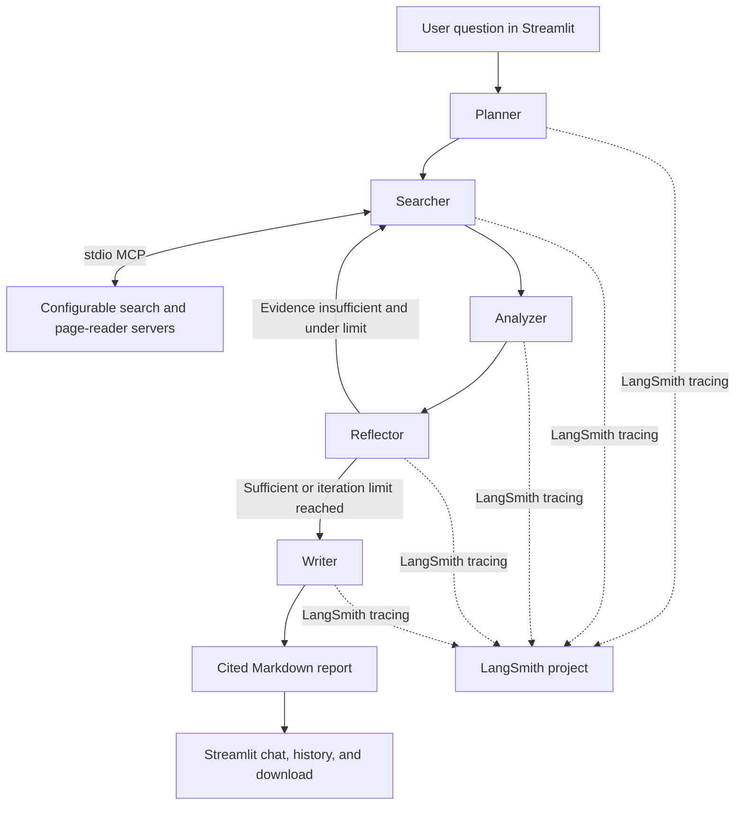

# AI Research Agent MCP

A Streamlit research assistant that plans a question, searches the web through
stdio MCP servers, checks its evidence, and produces a cited Markdown report.
The default model is Groq's `openai/gpt-oss-120b`; the model, temperature, and
maximum search passes can be changed in the sidebar. The requested
`llama-3.3-70b-versatile` default is no longer available to the configured
Groq account, so the app defaults to an available replacement.

## Architecture



The graph state is typed and persisted using LangGraph's in-memory
`MemorySaver`, keyed by the Streamlit conversation's `thread_id`. Search result
URLs are extracted from MCP outputs; the application builds the final clickable
Sources section from those URLs rather than trusting URLs generated by the LLM.
Groq temporary rate limits and transient API failures are retried with
exponential backoff.

## Requirements

- Python 3.11 or newer
- The `uv` package is installed with the project requirements; its `uvx`
  launcher starts the default DuckDuckGo MCP server
- A Groq API key from [console.groq.com](https://console.groq.com/)
- Optional: a LangSmith API key from [smith.langchain.com](https://smith.langchain.com/)

## Setup

### Windows PowerShell

```powershell
py -3.11 -m venv .venv
.\.venv\Scripts\Activate.ps1
python -m pip install --upgrade pip
pip install -r requirements.txt
Copy-Item .env.example .env
```

Edit `.env` and set `GROQ_API_KEY`. LangSmith tracing is optional; set
`LANGSMITH_API_KEY` and leave `LANGSMITH_TRACING=true` to enable it. The UI's
Groq API key field overrides the `.env` value for the current Streamlit
session.

### macOS and Linux

```bash
python3.11 -m venv .venv
source .venv/bin/activate
python -m pip install --upgrade pip
pip install -r requirements.txt
cp .env.example .env
```

Edit `.env` as described above. The default `mcp_servers.json` uses
`uvx --with "duckduckgo-mcp-server[browser]" duckduckgo-mcp-server`; the package
is fetched and launched on first use. No DuckDuckGo API key is required.

## Run

```bash
streamlit run app.py
```

Submit a question in the chat input. The collapsible progress view shows each
graph node. Reports include inline numbered citations, clickable source URLs,
and a Markdown download button. Use **New research** to start another
conversation; existing conversations remain available in Session history.

## Configure MCP search servers

Edit `mcp_servers.json` to replace or add servers. The `servers` object uses
the `MultiServerMCPClient` stdio configuration shape (`command`, `args`,
optional `env`, and `transport`). For example, a second MCP server can be
added without changing Python:

```json
{
  "search_server": "duckduckgo",
  "search_tool_names": ["search", "duckduckgo_search"],
  "fetch_tool_names": ["fetch", "read_page"],
  "fetch_server": "duckduckgo",
  "servers": {
    "duckduckgo": {
      "transport": "stdio",
      "command": "uvx",
      "args": [
        "--with",
        "duckduckgo-mcp-server[browser]",
        "duckduckgo-mcp-server"
      ],
      "env": {}
    },
    "brave-search": {
      "transport": "stdio",
      "command": "npx",
      "args": ["-y", "@modelcontextprotocol/server-brave-search"],
      "env": {"BRAVE_API_KEY": "${BRAVE_API_KEY}"}
    }
  }
}
```

Set `search_server` to the server to use and `search_tool_names` to its actual
search tool names. The example Brave entry is inactive until you select it as
`search_server`; set `BRAVE_API_KEY` in `.env` before doing so. `${ENV_NAME}`
values in a server's `env` map are resolved from the process environment and a
missing variable produces a clear configuration error. `fetch_server` is
optional and may name a separate server that provides a page-reader tool;
`fetch_tool_names` is optional too. For a server that uses a different launch
command, such as `uvx` or `python -m`, change only its `command` and `args`
values. The application starts the selected server(s) through
`MultiServerMCPClient` and discovers their tools with `await client.get_tools()`.
The DuckDuckGo server exposes `search` and `fetch_content`; the browser extra is
enabled so its automatic search fallback can handle blocked SERP responses.

## LangSmith traces and evaluation

With `LANGSMITH_TRACING=true`, `LANGSMITH_API_KEY`, and
`LANGSMITH_PROJECT=research-agent` in `.env`, graph calls are tagged
`research-agent` and include the conversation `thread_id` as run metadata.
Open the project in LangSmith to inspect planning, tool calls, analysis,
reflection loops, and report generation.

A small evaluation dataset can be created from representative questions and
expected properties (not necessarily a single exact report). Run this after
setting your LangSmith environment variables:

```python
from langsmith import Client

client = Client()
dataset = client.create_dataset(
    dataset_name="research-agent-smoke",
    description="Small set of research questions for checking report quality.",
)
client.create_examples(
    dataset_id=dataset.id,
    inputs=[
        {"question": "What are the main causes of coral bleaching?"},
        {"question": "How do heat pumps work in cold climates?"},
    ],
    outputs=[
        {"must_include": ["heat stress", "ocean warming"]},
        {"must_include": ["refrigerant", "low-temperature performance"]},
    ],
)
```

Use these examples in a LangSmith evaluation to review citation validity,
coverage, and factual grounding as the agent changes.

## Troubleshooting

- **Missing Groq API key:** set `GROQ_API_KEY` in `.env` or enter it in the
  sidebar. Restart the app after changing `.env`.
- **MCP executable not found:** run `pip install -r requirements.txt` in the
  activated project environment. The app checks the environment-local `uvx`
  launcher as well as `PATH`. The default search server is launched on demand.
- **MCP connection or tool discovery failed:** validate `mcp_servers.json`,
  check the command and args independently, and verify configured search tool
  names against the tools provided by that server.
- **No search tool detected:** set `search_tool_names` to one or more exact tool
  names exposed by the MCP server. The app also tries to infer tools from their
  name and description.
- **Groq rate limit or transient API error:** the agent retries temporary
  failures up to three times. Search results are capped and analyzed
  incrementally to keep requests within smaller token-per-minute limits. If
  the error persists, wait for quota to recover or use a lower-volume model.
- **Groq model not found:** model availability depends on the Groq account and
  changes over time. The default is `openai/gpt-oss-120b`, which was verified
  against the configured account; choose another currently available model in
  the sidebar if needed.
- **No citations in the report:** a source number is available only when an MCP
  result returned an HTTP(S) URL. Check the server response and tool schema.
- **LangSmith traces missing:** verify the key, project name, and
  `LANGSMITH_TRACING=true`, then restart Streamlit.
- **Memory is not retained after restart:** `MemorySaver` is in-memory and
  persists only while the app process is running. A durable checkpointer can be
  substituted when persistent storage is required.
